.. _andruav-de-native:

====================================
What Is New: DroneEngage Inside
====================================

Andruav 15 has a new engine. The phone now runs the **real DroneEngage
modules**, the same modules that run on a Raspberry Pi. Andruav and
DroneEngage now use one protocol, one WebClient and one account.

.. image:: /images/diagrams_2026/andruav_native_stack_2026.svg
   :align: center
   :alt: The DroneEngage modules de_comm, de_mavlink and andruav_phone inside the Andruav phone

|

.. list-table::
   :header-rows: 1
   :widths: 25 75

   * - Module
     - Job
   * - ``de_comm``
     - Connects the phone to the Mission Server (``cloud.ardupilot.org`` or
       your own :ref:`air-gap server <srv-airgap-servers>`).
   * - ``de_mavlink``
     - Connects to the ArduPilot flight controller. Sends telemetry and
       receives commands.
   * - ``andruav_phone``
     - Gives the phone parts to the system: the camera, the sound, the
       flash, the screen and the SMS.

.. tip::

   **Prove your idea on a phone. Ship it on DroneEngage.** A mission that
   works on Andruav works on a DroneEngage Raspberry Pi too. When people
   depend on the vehicle, move it to a Pi. You keep the same WebClient and
   the same account.

|

The Home Screen
===============

The home screen shows the state of the system on one page.

|pic_off| |pic_on|

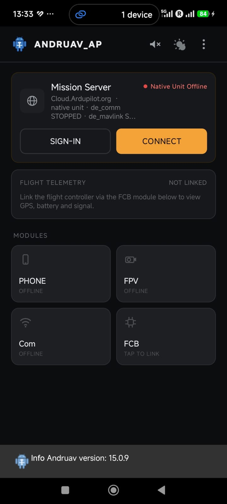

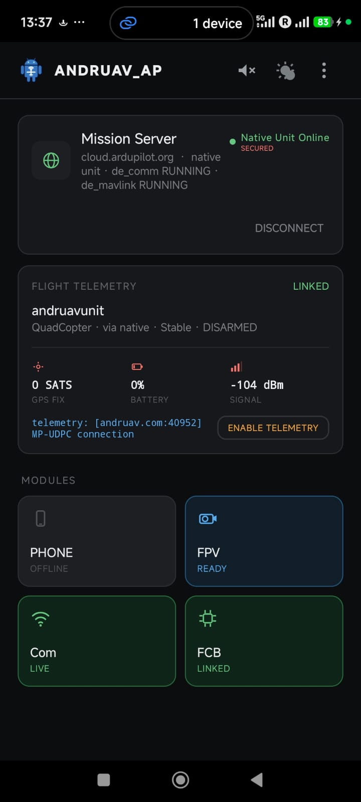

|

**Mission Server card**

* **SIGN-IN** opens the account screen. Enter your email and access code.
* **CONNECT** starts ``de_comm`` and ``de_mavlink``. The card then shows
  **Native Unit Online** and the state of each module.
* **SECURED** shows that the phone checks the TLS certificate of the server.
* **DISCONNECT** stops the modules.

**Flight Telemetry card**

* Shows the vehicle type, the link, the flight mode and the arm state.
* Shows the GPS satellites, the battery and the signal.
* **ENABLE TELEMETRY** opens a UDP port on the server for Mission Planner or
  QGroundControl. The card shows the address, for example
  ``andruav.com:40952``. Tap again to close it. See :ref:`andruav-telemetry`.

**Modules**

.. list-table::
   :header-rows: 1
   :widths: 15 85

   * - Tile
     - Tap it to
   * - **PHONE**
     - Open the phone screen: IMU, GPS and SMS (see below).
   * - **FPV**
     - Open the camera and the video stream. See :ref:`andruav-fpv`.
   * - **Com**
     - See the state of the server link.
   * - **FCB**
     - Connect the flight controller (see below).

A tile is green when its module is live. A tile is grey when its module is
offline.

|

Connect the Flight Controller
=============================

Tap the **FCB** tile. Select the link that your vehicle uses:

* **Bluetooth**
* **USB**
* **Wi-Fi / TCP-IP**
* **UDP Broadcast** — Andruav listens on a local port, for example ``14550``.

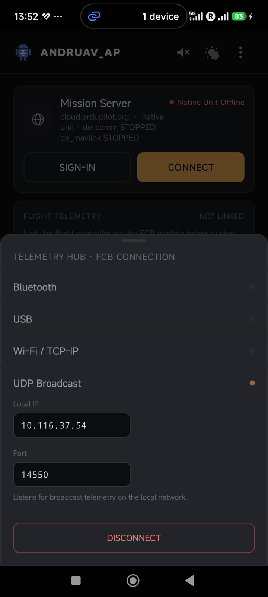

|

The WebClient can also send a connect command to the FCB. The phone then
links the FCB in the same way.

|

The PHONE Screen
================

Tap the **PHONE** tile. The screen has three tabs.

|pic_imu| |pic_gps| |pic_sms|

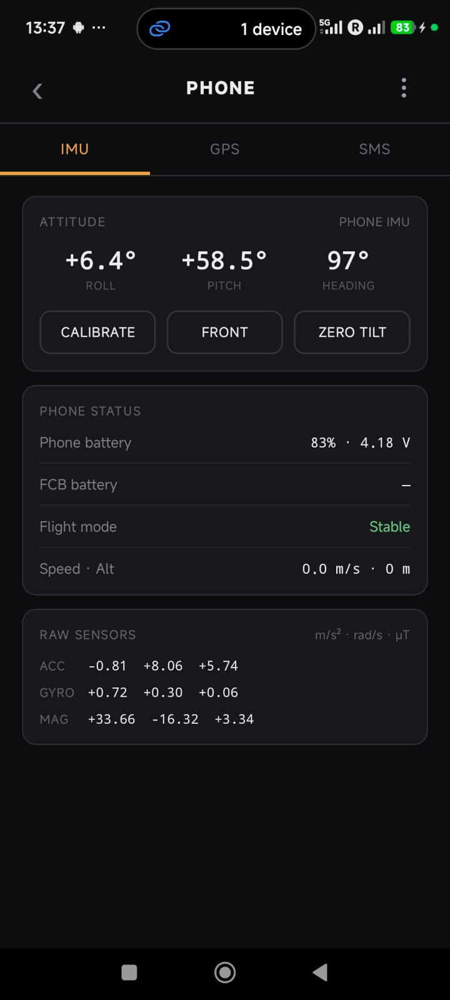

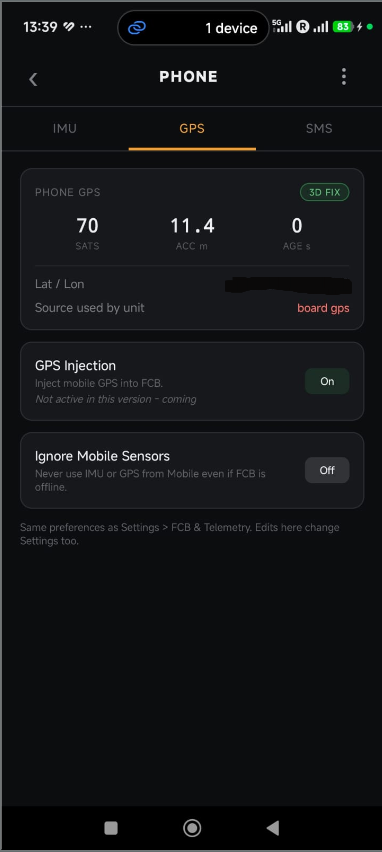

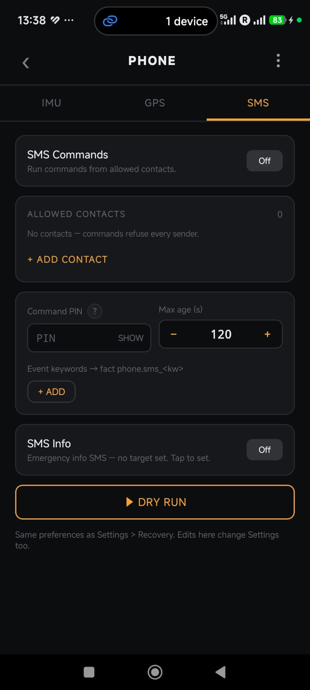

|

**IMU tab**

* Shows the roll, the pitch and the heading of the phone.
* **CALIBRATE**, **FRONT** and **ZERO TILT** set how the phone is mounted on
  the vehicle.
* Shows the phone battery, the FCB battery, the flight mode, the speed and
  the altitude.
* Shows the raw values of the accelerometer, the gyroscope and the compass.

**GPS tab**

* Shows the phone GPS fix: the satellites, the accuracy and the age.
* Shows which GPS the unit uses: the board GPS or the phone GPS.
* **GPS Injection** — *coming*. It is not active in this version. See
  :ref:`andruav-gps-injection`.
* **Ignore Mobile Sensors** — never use the IMU or the GPS of the phone.

**SMS tab**

* Control the vehicle with SMS when there is no internet. See
  :ref:`andruav-sms`.

|

Comm-Loss Failsafe
==================

When the link to the server stops, ``de_mavlink`` sets the flight
controller to a failsafe mode. It does this on the phone itself. It does not
need the app screen or a ground station.

#. Open **Settings**.
#. Go to **DroneEngage native**.
#. Turn on **Comm-loss flight failsafe**.
#. In **Failsafe flight mode**, select the mode: ``rtl`` (default),
   ``smart_rtl``, ``land``, ``loiter``, ``pos_hold`` or ``brake``.

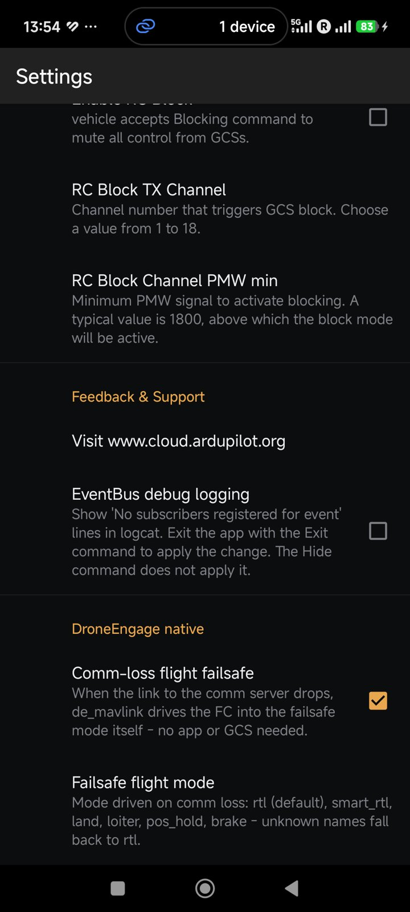

|

.. warning::

   Test the failsafe in SITL or on the ground first. See
   :ref:`andruav-simulators`.

|

Themes for Outdoor Use
======================

Open the menu (⋮) and tap **Theme**. Select:

* **Dark** — the default.
* **Light**
* **Sun** — high contrast and larger text for direct sunlight. You can also
  set **Full brightness in Sun**.
* **Follow system**

|pic_theme| |pic_sun|

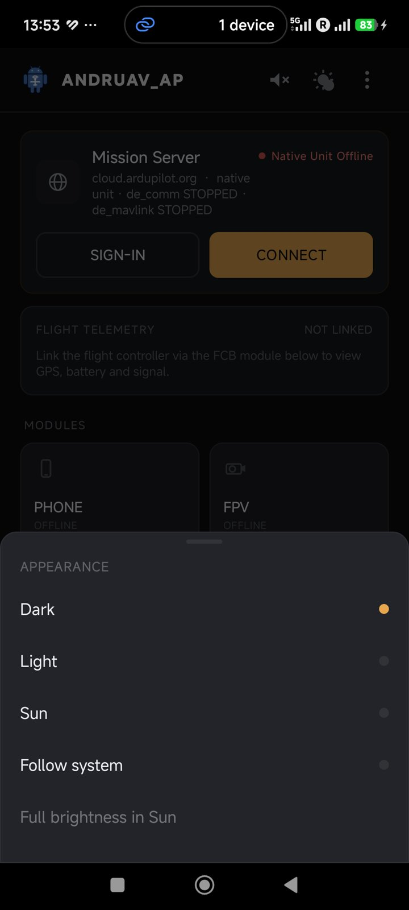

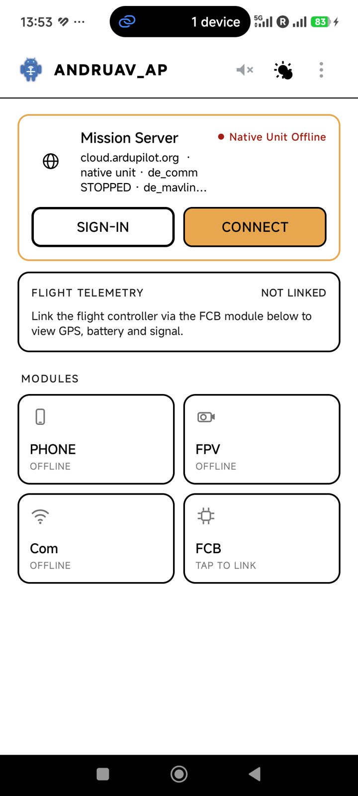

|

Settings
========

The settings are in groups. The main groups are:

.. list-table::
   :header-rows: 1
   :widths: 28 72

   * - Group
     - What you set
   * - Connection & Security
     - **Require SSL verification**. Keep it on. Turn it off only for a
       private server whose certificate the phone cannot check.
   * - FCB & Telemetry
     - Auto connect the FCB, auto start the app, ignore the phone sensors,
       GPS injection (*coming*).
   * - NTRIP / RTK
     - Caster, port, mountpoint and account (*coming*).
   * - FPV & Settings
     - The camera, the resolution, the RC camera switch, and the STUN / TURN
       servers for video.
   * - Safety & Recovery
     - Flight mode failsafe, minimum battery, flash screen and lost siren to
       find a lost vehicle, RC block.
   * - DroneEngage native
     - Comm-loss flight failsafe and its flight mode.

|pic_conn| |pic_safe|

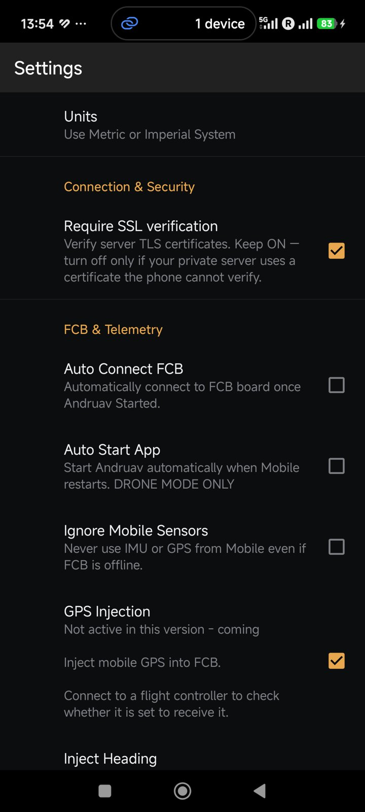

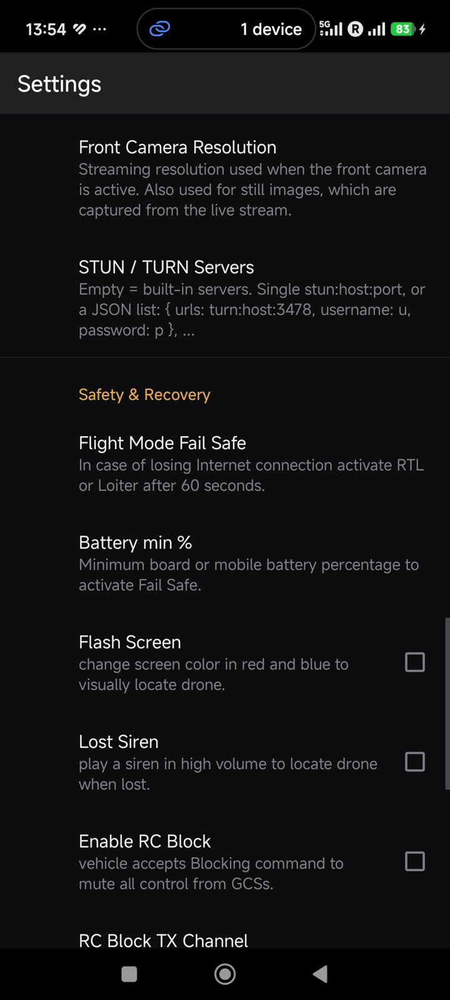

|

Permissions
===========

At the first start, Andruav asks for permissions. Andruav needs them for
these features:

.. list-table::
   :header-rows: 1
   :widths: 40 60

   * - Permission
     - Used for
   * - ``CAMERA``
     - FPV video and photos.
   * - ``ACCESS_FINE_LOCATION``
     - The phone GPS.
   * - ``READ_SMS``, ``SEND_SMS``, ``RECEIVE_SMS``
     - SMS commands and SMS info.
   * - ``READ_PHONE_STATE``
     - The mobile signal level.
   * - ``READ_MEDIA_*``
     - Saved photos, videos and sound files.
   * - ``POST_NOTIFICATIONS``
     - The notification that keeps Andruav on in the background.

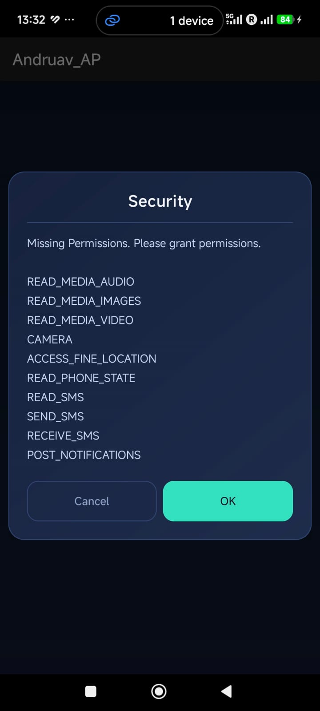

|

Tap **OK** and give each permission in the Android dialogs.
