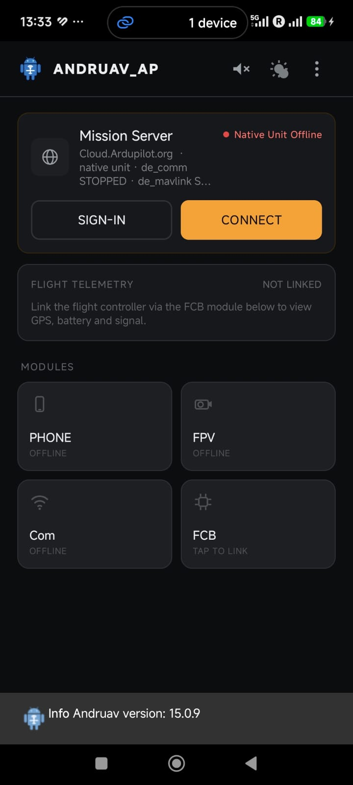

.. _andruav-getting-started:

=======================
Andruav Getting Started
=======================

You need:

* One Android phone. You put it on the vehicle (drone, boat or rover).
* An ArduPilot flight controller.
* An account and an **access code**.
* A computer or a phone with a browser for the :ref:`webclient-whatis`.

Andruav runs only on the vehicle. It is not a ground station app. You
monitor and control the vehicle from the WebClient.

|

1. Make an Account
==================

Open the `Account Manager <https://cloud.ardupilot.org:8001/accounts.html>`_.
Type your email and make an account. The page gives you an **access code**.
It also sends the access code to your email. Look in the spam folder too.

.. youtube:: baHWBc6RvaE

|

2. Sign In on the Phone
=======================

#. Install Andruav from `Google Play <https://play.google.com/store/apps/details?id=arudpilot.andruav>`_.
#. Open Andruav. Give the permissions that it asks for. See
   :ref:`andruav-de-native`.
#. On the Mission Server card, tap **SIGN-IN**.
#. Type your email and your access code.
#. Tap **CONNECT**. The card shows **Native Unit Online**.

|

3. Connect the Flight Controller
================================

Tap the **FCB** tile. Select Bluetooth, USB, Wi-Fi or UDP. See
:ref:`andruav-serial` and :ref:`andruav-de-native`.

|

4. Open the WebClient
=====================

Open the :ref:`webclient-whatis` and log in with the same email and access
code. The vehicle shows on the map. On a phone, use the
:ref:`webclient-mobile`.

|

.. warning::
    Do not give your access code to other persons. With your access code,
    a person can add devices to your account and see your vehicles. Give it
    only to a person who must watch or control the same vehicles.
