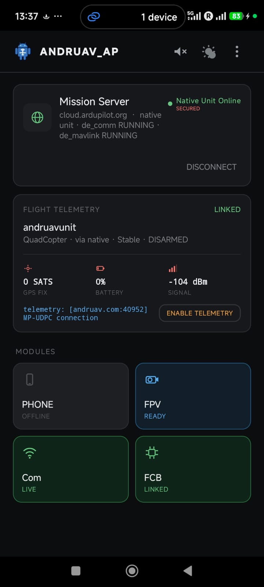
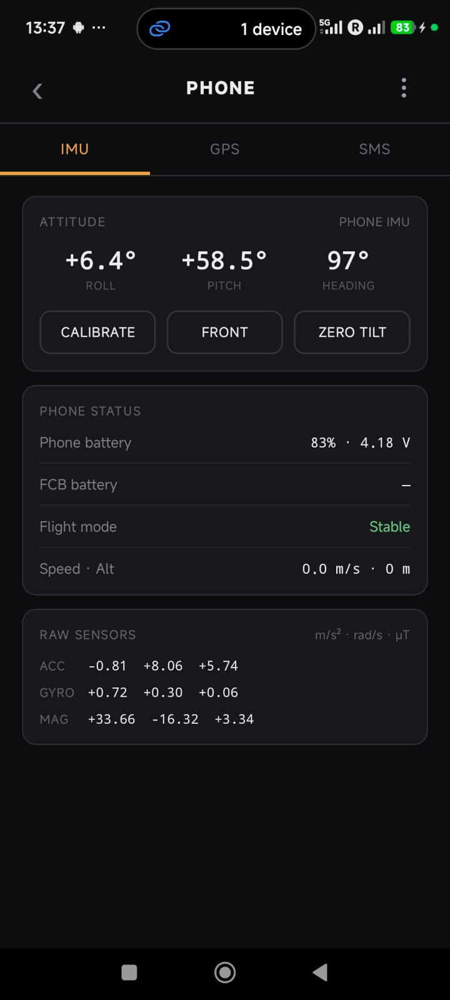

.. _andruav-index:

=======
Andruav
=======

**One phone. Any vehicle. Air, land or water.**

Andruav is the companion computer that everybody already owns. Put an
Android phone on your drone, boat or rover. Andruav connects it to the
ArduPilot flight controller and to the cloud. You get telemetry with no
range limit, live FPV video, and a link to Mission Planner.

.. youtube:: ak4IFExkYsA

|

.. tip::

   **Download Andruav** on `Google Play <https://play.google.com/store/apps/details?id=arudpilot.andruav>`_.

|

New in Andruav 15: DroneEngage Inside
=====================================

The phone now runs the real DroneEngage modules, the same modules that run
on a Raspberry Pi. **Prove your idea on a phone. Ship it on DroneEngage.**

.. image:: /images/diagrams_2026/andruav_native_stack_2026.svg
   :align: center
   :alt: The DroneEngage modules inside the Andruav phone, between the Mission Server and the flight controller

|

|pic_de_home| |pic_de_imu|

|

- **New home screen** — the server, the flight telemetry and the four
  modules (PHONE, FPV, Com, FCB) on one page.
- **PHONE screen** — the phone IMU, the phone GPS and the SMS settings in
  three tabs.
- **Comm-loss failsafe** — if the server link stops, the phone sets the
  flight controller to RTL, LAND or another mode that you select.
- **Safer SMS control** — allowed contacts, a PIN, a lockout and a dry run.
- **One-tap telemetry** — open or close the Mission Planner UDP link from
  the home screen.
- **Sun theme** — high contrast for direct sunlight.
- **Your own server** — connect to ``cloud.ardupilot.org`` or to your own
  :ref:`air-gap server <srv-airgap-servers>`.

See :ref:`andruav-de-native` for all the new features.

|

One Phone on the Vehicle. The WebClient on the Ground.
======================================================

Put one Android phone with Andruav on your drone, boat or rover. This phone
is the companion computer. It talks to the ArduPilot flight controller and to
the cloud over Wi-Fi or 3G/4G/5G, so the range is not limited by a radio.

Andruav is **not** a ground station app. You control the vehicle from the
:ref:`WebClient <webclient-whatis>` in a browser. On a phone, open the
:ref:`webclient-mobile`. It has the map, the flight controls, the FPV video
and the unit status. You do not install an app.

|pic_home| |pic_mobile|

.. |pic_mobile| image:: ./images/new_andruav_2026/webclient_mobile_andruav_connected.png
   :height: 500px
   :alt: The /mobile browser view, connected and flying — no app install needed

|

See What Your Drone Sees
=========================

Andruav turns your drone-side phone's camera into an FPV feed — no analog
gear, no extra antennas. Stream it to multiple ground stations at once, in
different places in the world, all watching the same flight live.

.. image:: ./images/new_andruav_2026/andruav_fpv.png
   :width: 90%
   :align: center
   :alt: Live FPV video from the phone camera

|

- Zoom, flash, and front/rear camera switching mid-flight
- Picture-in-picture — the feed keeps streaming while you use the rest of the app
- Local and remote recording, with GPS-tagged snapshots plotted on a map
- Full detail in :ref:`andruav-fpv`

|

Plays Nice With Mission Planner
================================

Andruav isn't a closed box. Its built-in UDP proxy forwards live telemetry
straight into Mission Planner or QGroundControl over UDPCI — configure it
once from the phone or the web client and fly with the GCS you already
know. It's the same link that carried radio control input for a demo drive
between Cairo and Los Angeles: 12,193 km, controller in one city, car
moving in the other. See :ref:`andruav-telemetry` and
:ref:`webclient-udp-telemetry`.

.. image:: ./images/new_andruav_2026/andruav_comm_server.png
   :height: 500px
   :align: center
   :alt: Comm Server connection settings

|

Connect Your Flight Controller
===============================

Bluetooth, USB, WiFi, or UDP — Andruav links to your ArduPilot board however
your build is wired.

.. image:: ./images/new_andruav_2026/andruav_fcb_bluetooth.png
   :height: 480px
   :align: center
   :alt: Flight controller connection sheet with Bluetooth, USB, WiFi and UDP options

|

Get Started
============

#. `Download Andruav from Google Play <https://play.google.com/store/apps/details?id=arudpilot.andruav>`_.
#. Create a free account and get your **access code** — see :ref:`andruav-getting-started`.
#. Mount the drone-side phone, pair your flight controller, and you're airborne.

|

For Developers
================

Andruav is part of the `Ardupilot Cloud EcoSystem <https://cloud.ardupilot.org>`_
and its source is public. For an AI-generated, always-current tour of the
codebase, see the DeepWiki pages for `DroneEngage <https://deepwiki.com/DroneEngage>`_
and the `Andruav Android app <https://deepwiki.com/HefnySco/andruav_android_app>`_.

|

.. toctree::
   :caption: Contents:
   :titlesonly:
   :maxdepth: 1

   What is Andruav </andruav-what-is>
   What Is New: DroneEngage Inside </andruav-de-native>
   Getting Started </andruav-getting-started>
   Settings </andruav-settings>
   How to Build </andruav-how-to-compile>
   Andruav Serial Port </andruav-serial>
   Andruav FPV </andruav-fpv>
   Andruav Telemetry </andruav-telemetry>
   Andruav Advanced Features </andruav-advanced>
   GPS Injection </andruav-gps-injection>
   SMS Reporting & Control </andruav-sms>
   RC Blocking </de-tx-block>
   TX Freeze </de-tx-freeze>
   Geo-Fencing </de-geo-fencing>
   Using Andruav with SITL </andruav-simulators>
   FAQ </andruav-faq>
   Deprecated Features </obsolete-index>
