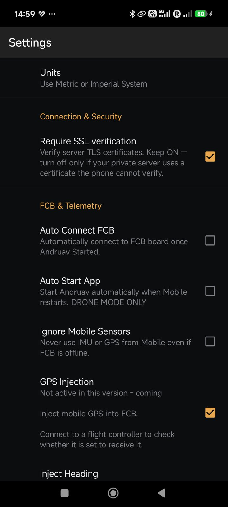
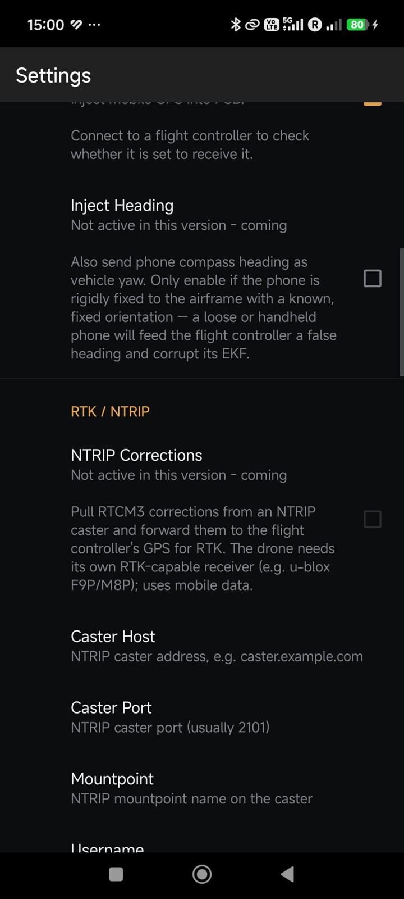
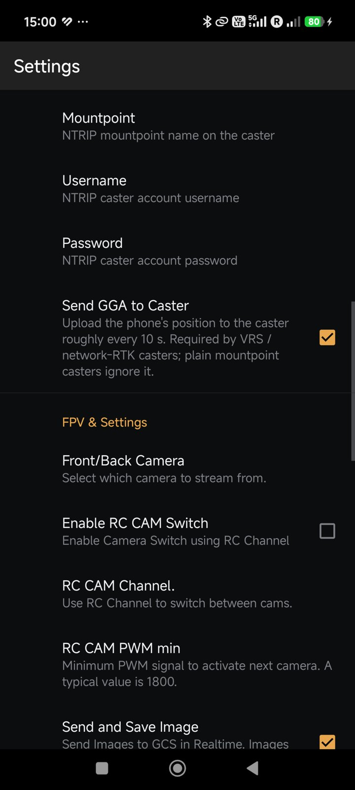
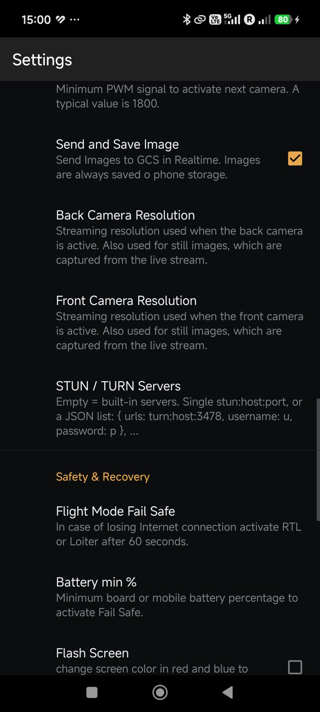
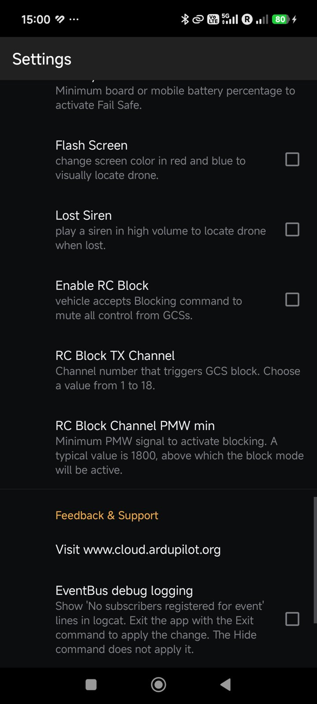
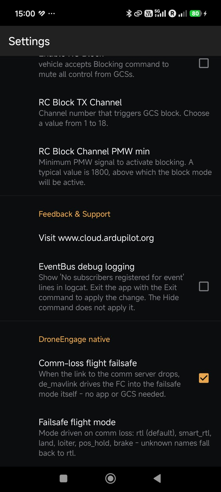

.. _andruav-settings:

================
Andruav Settings
================

To open the settings:

#. On the home screen, tap the menu (⋮).
#. Tap **Settings**.

The settings are in groups. This page shows each group in the order of the
screen.

.. note::

   Some settings are also on other screens. The **PHONE > GPS** tab and the
   **PHONE > SMS** tab use the same values. A change in one place changes the
   other place too.

|

Connection, FCB and Telemetry
=============================

|

.. list-table::
   :header-rows: 1
   :widths: 30 70

   * - Setting
     - What it does
   * - **Units**
     - Use metric or imperial units.
   * - **Require SSL verification**
     - Check the TLS certificate of the server. Keep it on. Turn it off only
       for a private server whose certificate the phone cannot check, for
       example a test :ref:`air-gap server <srv-airgap-servers>`.
   * - **Auto Connect FCB**
     - Connect to the flight controller when Andruav starts.
   * - **Auto Start App**
     - Start Andruav when the phone starts.
   * - **Ignore Mobile Sensors**
     - Never use the IMU or the GPS of the phone, also when the flight
       controller is offline.
   * - **GPS Injection**
     - *Coming.* Send the phone GPS to the flight controller. See
       :ref:`andruav-gps-injection`.
   * - **Inject Heading**
     - *Coming.* Also send the phone compass heading. Use it only if the
       phone is fixed tightly to the frame.

|

RTK / NTRIP
===========

|

*Coming.* These settings are not active in this version.

.. list-table::
   :header-rows: 1
   :widths: 30 70

   * - Setting
     - What it does
   * - **NTRIP Corrections**
     - Get RTCM3 corrections from an NTRIP caster and send them to the GPS of
       the flight controller.
   * - **Caster Host**, **Caster Port**
     - The address of the caster. The port is usually 2101.
   * - **Mountpoint**
     - The mountpoint name on the caster.
   * - **Username**, **Password**
     - Your caster account.
   * - **Send GGA to Caster**
     - Send the phone position to the caster about every 10 s. VRS and
       network RTK casters need it.

|

FPV and Camera
==============

|pic_fpv| |pic_video|

|

.. list-table::
   :header-rows: 1
   :widths: 30 70

   * - Setting
     - What it does
   * - **Front/Back Camera**
     - Select the camera for the stream.
   * - **Enable RC CAM Switch**
     - Change the camera with an RC channel.
   * - **RC CAM Channel**, **RC CAM PWM min**
     - The RC channel, and the PWM value (typically 1800) above which the
       next camera is selected.
   * - **Send and Save Image**
     - Send photos to the ground station at once. The phone always keeps a
       copy.
   * - **Back / Front Camera Resolution**
     - The stream resolution of each camera. Photos use the same resolution.
   * - **STUN / TURN Servers**
     - The servers for the video link. Keep it empty to use the built-in
       servers. On an air-gap server, write the address of its TURN server.

See :ref:`andruav-fpv` for the video features.

|

Safety and Recovery
===================

|

.. list-table::
   :header-rows: 1
   :widths: 30 70

   * - Setting
     - What it does
   * - **Flight Mode Fail Safe**
     - If the internet link is lost for 60 seconds, set RTL or Loiter.
   * - **Battery min %**
     - The battery level of the board or the phone that starts the fail safe.
   * - **Flash Screen**
     - Flash the phone screen red and blue, so you can find the vehicle.
   * - **Lost Siren**
     - Play a loud siren, so you can find a lost vehicle.
   * - **Enable RC Block**
     - Let the pilot block all control from the ground stations with an RC
       switch. See :ref:`de-tx-block`.
   * - **RC Block TX Channel**, **RC Block Channel PWM min**
     - The RC channel (1 to 18), and the PWM value (typically 1800) above
       which the block is active.

|

DroneEngage Native
==================

|

.. list-table::
   :header-rows: 1
   :widths: 30 70

   * - Setting
     - What it does
   * - **Comm-loss flight failsafe**
     - When the link to the server stops, ``de_mavlink`` sets the flight
       controller to the failsafe mode. It needs no app screen and no ground
       station.
   * - **Failsafe flight mode**
     - The mode to set: ``rtl`` (default), ``smart_rtl``, ``land``,
       ``loiter``, ``pos_hold`` or ``brake``. An unknown name gives ``rtl``.

.. warning::

   Test each failsafe in SITL before a real run. See :ref:`andruav-simulators`.

|

Feedback and Support
====================

* **Visit www.cloud.ardupilot.org** — opens this wiki.
* **EventBus debug logging** — for developers only. It adds lines to the
  Android log.
