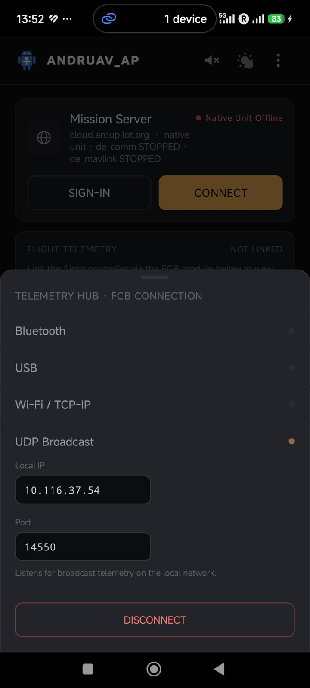
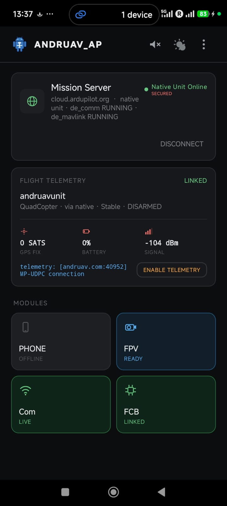

.. _andruav-simulators:

=============================
Andruav Simulation using SITL
=============================

You do not need a real vehicle to test Andruav. Use
`SITL <https://ardupilot.org/dev/docs/sitl-simulator-software-in-the-loop.html>`_
before you use Andruav on a real drone, boat or rover. SITL can simulate
ArduCopter, ArduPlane, ArduRover (rovers and boats) and ArduSub.

For a 3D view, you can also use
`Webots SITL <https://ardupilot.org/dev/docs/sitl-with-webots.html>`_.

.. youtube:: c5CJaRH9Pig

|

Connect Andruav to SITL
=======================

Andruav connects to SITL over UDP. The phone and the SITL computer must be
on the same network.

**On the SITL computer**

Start SITL and send MAVLink to the IP of the phone:

.. code-block:: bash

    ~/ardupilot/Tools/autotest/sim_vehicle.py -j4 -v ArduCopter -M \
        --out=udpout:127.0.0.1:14550 \
        --out=udpout:192.168.1.100:14550

In this example:

* ``127.0.0.1:14550`` is for a Mission Planner or QGroundControl on the
  same computer. It does not go through Andruav.
* ``192.168.1.100:14550`` is the phone. Change it to the IP of your phone.

For a rover, use ``-v Rover``. For a boat, use ``-v Rover --frame=motorboat``.

**On the phone**

#. On the home screen, tap the **FCB** tile.
#. Tap **UDP Broadcast**.
#. Make sure that **Port** is the same port as in the SITL command (``14550``).
   The sheet shows the **Local IP** of the phone. Use this IP in the SITL
   command.
#. Tap **CONNECT**.

|

.. tip::
    Give your phone a static IP on your router. Then you do not change the
    SITL command each time.

|

Check the Link
==============

When Andruav receives MAVLink from SITL:

* The **FCB** tile becomes green and shows **LINKED**.
* The **Flight Telemetry** card shows the vehicle type, for example
  *QuadCopter via native*, the flight mode and the arm state.

|

Then tap **CONNECT** on the Mission Server card. Open the WebClient, and
control the simulated vehicle from there.

|

Test the Comm-Loss Failsafe in SITL
===================================

Use SITL to test the :ref:`comm-loss failsafe <andruav-de-native>` before a
real run:

#. Turn on **Settings > DroneEngage native > Comm-loss flight failsafe**.
#. Select the **Failsafe flight mode**, for example ``rtl``.
#. In SITL, arm the vehicle and take off.
#. Stop the server link of the phone.
#. Make sure that the vehicle changes to the failsafe mode.

.. note::

   The SITL link and the server link must be different. For example, use
   Wi-Fi for SITL and mobile data for the server. Then turn off only the
   mobile data in step 4.

|

Testing GPS Injection in SITL
=============================

GPS Injection is *coming* and is not active in this version. When it is
available, see :ref:`andruav-gps-injection-sitl` for the SITL parameters.
