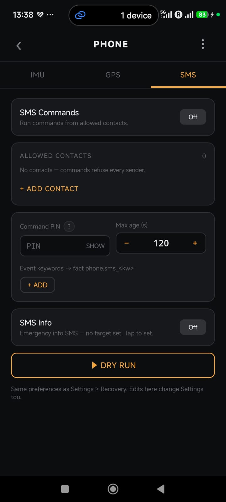

.. _andruav-sms:

===============================
Andruav SMS Reporting & Control
===============================

The phone on the vehicle can send and receive SMS. Use SMS when the
internet link is slow or lost:

* Send a command to the vehicle, for example RTL or LAND.
* Get the location of a lost vehicle.
* Start a step of a DroneEngage mission with a keyword.

|

Open the SMS Settings
=====================

#. On the home screen, tap the **PHONE** tile.
#. Tap the **SMS** tab.

The SMS tab and **Settings > Recovery** use the same values. A change in one
place changes the other place too.

|

Set Up SMS Commands
===================

Each command must pass all of these checks. If one check fails, Andruav
does not do the command.

.. list-table::
   :header-rows: 1
   :widths: 25 75

   * - Check
     - Rule
   * - SMS Commands
     - The switch must be **On**.
   * - Allowed contacts
     - The sender must be on the list. With no contacts, Andruav refuses
       every sender.
   * - Format
     - The message must be ``ATT:<command>:<PIN>``.
   * - Command PIN
     - The PIN in the message must be correct. The PIN has a maximum of 4
       digits.
   * - Lockout
     - After 5 wrong PINs in 10 minutes, Andruav refuses all commands for
       10 minutes.
   * - Max age
     - The SMS must not be older than this time (default 120 s). An old SMS
       that arrives late is not used.

Steps:

#. Turn on **SMS Commands**.
#. Tap **+ ADD CONTACT**. Add the phone number of each person who can send
   commands.
#. Type a **Command PIN**.
#. Set the **Max age**, if necessary.

.. tip::

   Each accepted or refused SMS shows as a message in the WebClient. The
   message shows the contact name, not the phone number.

|

SMS Commands
============

.. list-table::
   :header-rows: 1
   :widths: 35 65

   * - Message
     - What it does
   * - ``ATT:HLP:<PIN>``
     - Sends back the list of commands.
   * - ``ATT:RTL:<PIN>``
     - Sets the flight mode to RTL (Return to Launch).
   * - ``ATT:LND:<PIN>``
     - Sets the flight mode to LAND. ``ATT:LAND:<PIN>`` also works.
   * - ``ATT:LOC:<PIN>``
     - Sends back the location of the vehicle.
   * - ``ATT:AUTO 3:<PIN>``
     - Starts the AUTO mission at step 3.
   * - ``ATT:<keyword>:<PIN>``
     - Sends a keyword event to the DroneEngage mission (see below).

**Example:** to send the vehicle home with the PIN 1234, send
``ATT:RTL:1234``.

.. note::

   If the RC block is active (a pilot has manual control), Andruav does not
   do RTL or LAND from SMS.

|

Keywords for Missions
=====================

You can add your own keywords. A keyword does not move the vehicle by
itself. It gives an event to the DroneEngage mission, and the mission
decides what to do.

#. Under **Event keywords**, tap **+ ADD**.
#. Type a word, for example ``go``.
#. In the mission, use the fact ``phone.sms_go``.

When an allowed contact sends ``ATT:go:<PIN>``, the fact ``phone.sms_go``
becomes true in the mission.

A keyword cannot have the name of a built-in command, such as ``rtl``.

|

SMS Info
========

**SMS Info** sends an emergency SMS with the location of the vehicle to one
phone number.

#. Tap the **SMS Info** card.
#. Type the phone number that gets the emergency SMS.
#. Turn on **SMS Info**.

|

Test with DRY RUN
=================

Before a flight, test your setup with **DRY RUN**. The dry run does not
move the vehicle.

#. Tap **DRY RUN**.
#. Select a sender and a message.
#. Read the result. It shows each check and if it passed or failed.

.. warning::

   SMS can arrive late or not at all. Do not use SMS as your only safety
   link. Also set the :ref:`comm-loss failsafe <andruav-de-native>`.
