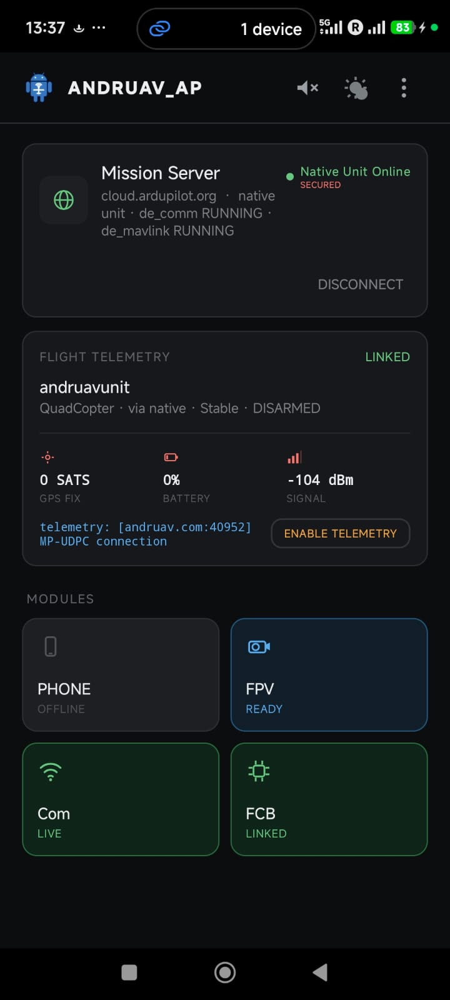

.. _andruav-telemetry:

=================
Andruav Telemetry
=================

Andruav connects to `ArduPilot flight controllers <https://ardupilot.org/copter/docs/common-autopilots.html>`_
over Bluetooth, USB, Wi-Fi (TCP) or UDP. Then it sends the telemetry to the
server over the internet, so the range has no limit.

To use Mission Planner or QGroundControl with the vehicle:

#. On the Andruav home screen, tap **ENABLE TELEMETRY**.
#. The Flight Telemetry card shows an address, for example ``andruav.com:40952``.
#. In Mission Planner, connect with **UDPCI** to this address.

You can also do this from the WebClient. See :ref:`webclient-udp-telemetry`.

|

The below video might be a record-breaking telemetry range for RC. In the following video you can see a car is being control in Cairo Egypt.driver is in Los-Angeles USA. **Andruav 12,193 km RC Car Demo**.

The first Video captured in USA

.. youtube:: DmpX-D10GyQ

While the second is captured in Egypt

.. youtube:: Kh4NU3FaFeE

Both are the same exact video filmed from two places.

.. tip::

   **Andruav 12,193 km RC Car Demo** :ref:`here <andruav-telemetry>` is done by connecting joystick to Mission Planner via Andruav Telemetry. However it is recommended to use :ref:`GamePad Directly <webclient-gamepad>`.

