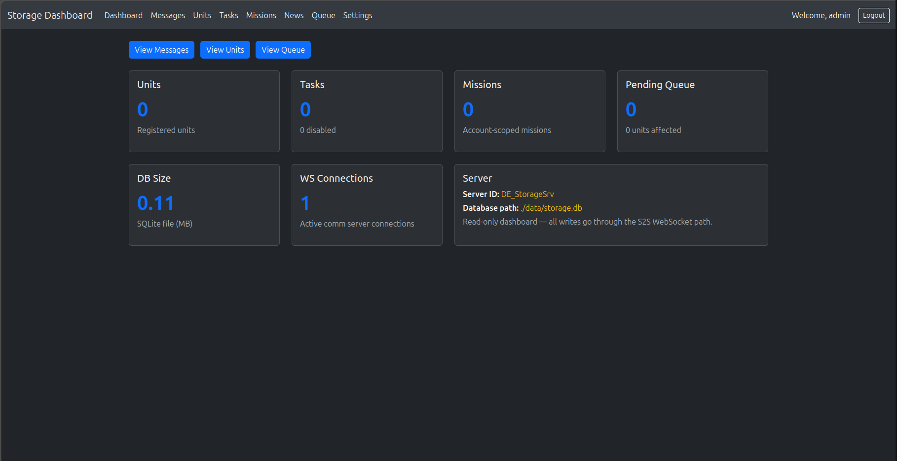
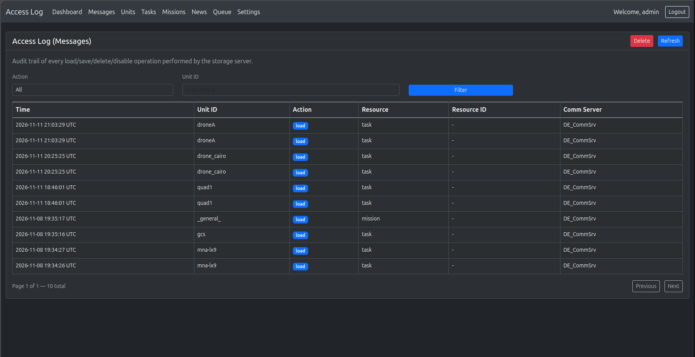
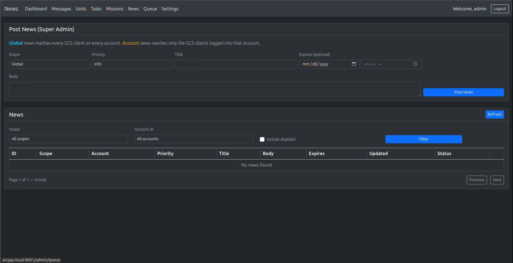

.. _srv-storage:

==============
Storage Server
==============

The **Storage Server** keeps the data that must stay after a unit or a
WebClient disconnects. It is a new server. The earlier Node.js backend did
not have it.

.. code-block:: text

    Units / WebClient  <-->  Communication Server  <-->  Storage Server  <-->  SQLite file

What It Does
============

- Keeps **tasks**, **missions** and **news** for each account.
- Keeps messages for a unit that is offline (the **offline queue**). When
  the unit connects again, the unit gets these messages.
- Stores all data in one SQLite file. You do not need a database server.
- Sends **news** to all WebClients of the system, or of one account, at once.
- Has an **admin dashboard** to monitor the data, post news and set the
  quotas.

Units and the WebClient never connect to the Storage Server. Only the
Communication Server connects to it, over an S2S link.

**Program:** ``de_storage_server`` · **Source code:**
`droneengage_storage_server <https://github.com/DroneEngage/droneengage_storage_server>`_

Admin Dashboard
===============

The dashboard is a web page of the Storage Server.

#. Open ``https://<pi-address>:9001/admin/login``. If you set
   ``dashboard_url_guid``, open ``https://<pi-address>:9001/admin/<guid>/login``.
#. Log in with ``admin_username`` and ``admin_password``.

|

.. note::

   In the default ``server.config``, the dashboard listens on ``127.0.0.1``
   only. Set ``dashboard_listening_ip`` to ``0.0.0.0`` to open it from the
   network. On the air-gap card it is open on the Wi-Fi:
   ``https://airgap.local:9001/admin/login``. After 5 wrong logins, the dashboard locks that
   user for 30 minutes.

.. list-table::
   :header-rows: 1
   :widths: 20 80

   * - Page
     - What you can do
   * - **Dashboard**
     - See the number of units, tasks, missions and queued messages, the
       database size and the WebSocket connections.
   * - **Messages**
     - See the access log of the storage requests. You can clear it.
   * - **Units**
     - See the units that use the Storage Server.
   * - **Tasks**
     - See the saved tasks.
   * - **Missions**
     - See the saved missions of each account. You can delete a mission.
   * - **News**
     - Post, enable, disable and delete news (see below).
   * - **Queue**
     - See the offline messages that wait for a unit.
   * - **Settings**
     - Set the quotas for each account. The dashboard saves them in
       ``server.config.local``.

**Messages page** — each load, save, delete and disable request, with the
time, the unit, the resource and the Communication Server. Use **Filter** to
find the requests of one unit. **Delete** clears the log.

|

News Across the System
======================

News is a short message that shows in the **news panel** of each WebClient.
Use it to tell all operators about a server update, a weather warning or a
change in the plan.

.. image:: /images/diagrams_2026/storage_news_flow_2026.svg
   :align: center
   :alt: The admin or a WebClient user posts news, the Storage Server saves it and pushes it through the Communication Servers to the WebClients

|

**Who can post**

.. list-table::
   :header-rows: 1
   :widths: 25 25 50

   * - Scope
     - Posted from
     - Who sees it
   * - **Global**
     - The storage dashboard only
     - All WebClients of all accounts.
   * - **Account**
     - The storage dashboard, or the **Post News** panel of the WebClient
     - Only the WebClients of that account.

**Post news from the dashboard**

|

#. Open the **News** page.
#. Select the scope: **Global** or **Account**. For **Account**, type the
   account ID.
#. Type the title and the text.
#. Select the priority: **Info**, **Warning** or **Critical**.
#. If necessary, set the expiry time. After this time the news does not show.
#. Click **Post News**.

The list under the form shows the news. Filter it by scope or account. Select
**Include disabled** to see the disabled news too.

The Storage Server saves the news and pushes it at once. WebClients that are
open show it immediately. A WebClient that opens later loads the active
news.

**Remove news**

* **Disable** hides the news. You can enable it again.
* **Delete** removes the news permanently.

.. tip::

   Use ``max_news_per_account`` (in the **Settings** page or in ``limits``)
   to stop one account from filling the news panel.

Settings
========

The settings are in ``server.config``. Put your changes in
``server.config.local`` (see :ref:`srv-airgap-servers`).

.. list-table::
   :header-rows: 1
   :widths: 30 20 50

   * - Setting
     - Default
     - What it does
   * - ``server_id``
     - ``DE_StorageSrv``
     - The name of this server.
   * - ``server_ip``
     - ``127.0.0.1``
     - The IP that the server listens on. Keep ``127.0.0.1`` when the
       Communication Server is on the same Pi.
   * - ``server_port``
     - ``9000``
     - The port of the S2S link.
   * - ``enable_SSL``
     - ``true``
     - Use a secure WebSocket (WSS).
   * - ``s2s_cert_enabled``
     - ``false``
     - ``false``: accept the Communication Server with the shared secret.
       ``true``: accept it with an Ed25519 public key from
       ``s2s_trusted_server_keys``.
   * - ``s2s_shared_secret_file``
     - ``./s2s_shared_secret.key``
     - The file of the shared secret. The server makes it with a random
       value at the first start.
   * - ``database.path``
     - ``./data/storage.db``
     - The SQLite file. The server makes it at the first start.
   * - ``queue.maxQueueSize``
     - ``1000``
     - The maximum number of offline messages for each unit.
   * - ``limits``
     - see below
     - Limits for each account, so that one account cannot fill the disk.
       You can also change them on the dashboard **Settings** page.
   * - ``dashboard_url_guid``
     - empty
     - A secret word. When set, the dashboard is only at
       ``/admin/<word>/...``.
   * - ``dashboard_enable``
     - ``true``
     - Show the admin dashboard.
   * - ``dashboard_port``
     - ``9001``
     - The port of the dashboard.
   * - ``dashboard_listening_ip``
     - ``127.0.0.1``
     - The dashboard is on the Pi only. Set ``0.0.0.0`` to open it to the
       network.
   * - ``admin_username``, ``admin_password``
     - ``admin``, ``CHANGE_ME``
     - The dashboard login. Change the password. You can write
       ``$$HASH$$('password')``.
   * - ``session_secret``
     - —
     - A long random text that protects the dashboard sessions.

.. code-block:: json

    {
        "server_id"              : "DE_StorageSrv",
        "server_ip"              : "127.0.0.1",
        "server_port"            : 9000,
        "enable_SSL"             : true,
        "ssl_key_file"           : "./ssl_local/ssl_airgap/domain.key",
        "ssl_cert_file"          : "./ssl_local/ssl_airgap/domain.crt",
        "ca_cert_path"           : "./ssl_local/ssl_airgap/root.crt",

        "s2s_cert_enabled"       : false,
        "s2s_shared_secret_file" : "./s2s_shared_secret.key",

        "database": { "path": "./data/storage.db", "maxConnections": 10 },
        "queue":    { "maxQueueSize": 1000, "retryInterval": 5000 },

        "dashboard_enable"       : true,
        "dashboard_port"         : 9001,
        "dashboard_listening_ip" : "127.0.0.1",
        "admin_username"         : "admin",
        "admin_password"         : "$$HASH$$('my-new-password')",
        "session_secret"         : "write-a-long-random-text-here",

        "limits": {
            "max_news_per_account"     : 50,
            "max_missions_per_account" : 200,
            "max_missions_per_unit"    : 50,
            "max_mission_bytes"        : 1048576
        }
    }

Connect the Communication Server
================================

Set these values in the config of the :ref:`srv-communication`:

.. code-block:: json

    {
        "enable_storage_server"  : true,
        "storage_server_host"    : "127.0.0.1",
        "storage_server_port"    : 9000,
        "s2s_shared_secret_file" : "./s2s_shared_secret.key"
    }

Copy ``s2s_shared_secret.key`` from the Storage Server folder to the
Communication Server folder. The two files must be the same.

Back Up the Data
================

All data is in one file: ``data/storage.db``. To back it up:

#. Stop the server:

   .. code-block:: bash

       sudo systemctl stop de_storage

#. Copy ``data/storage.db`` to a safe place.
#. Start the server again:

   .. code-block:: bash

       sudo systemctl start de_storage

Related Pages
=============

- :ref:`srv-airgap-servers` — all four servers and their ports.
- :doc:`Storage Server Technicals <technicals/server/de-server-technicals-storage-overview>` — the database schema and the message protocol.
